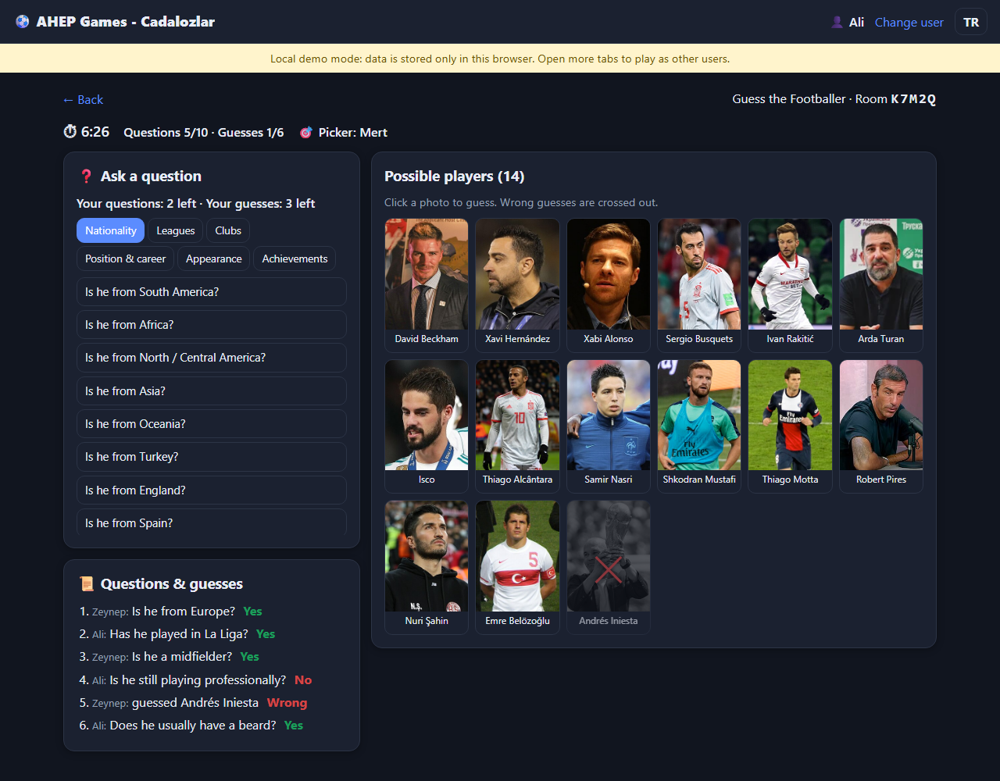
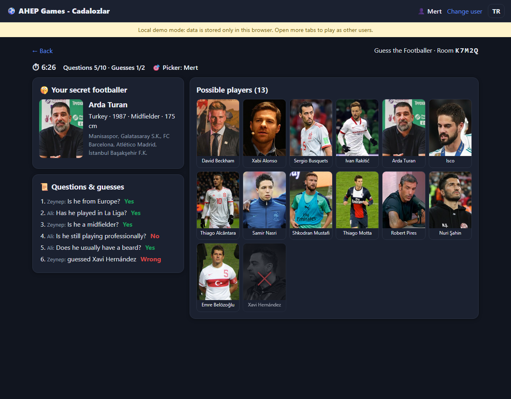
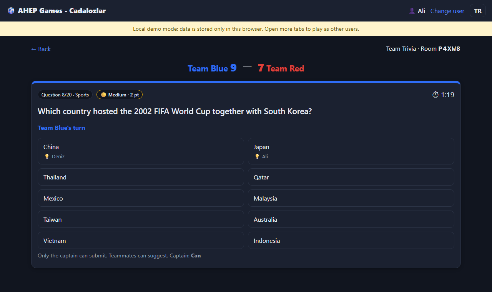
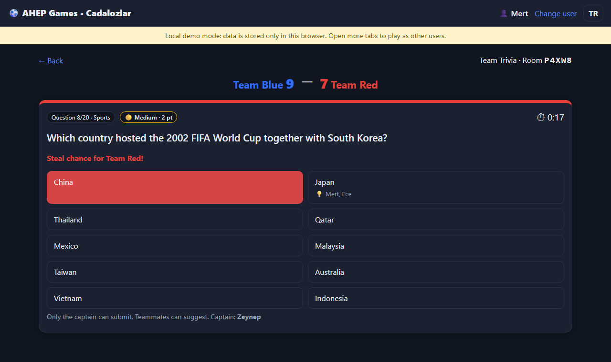

# AHEP Games - Cadalozlar ⚽🧠

Multiplayer games for friends: **Guess the Footballer**, **Team Trivia**, **Academic Quiz**,
**Team & Nation Guess** and **Transfer Auction**.
Users only pick a username (no password); points are stored per user per game.

- Hosting: GitHub Pages (free)
- Database: Firebase Realtime Database + Anonymous Auth (free Spark plan)
- No build step: plain HTML/JS modules

| Guess the Footballer (guesser) | Guess the Footballer (picker) |
|---|---|
|  |  |
| **Team Trivia (answering team)** | **Team Trivia (steal chance)** |
|  |  |

Add `?demo` to the site URL to try it in local demo mode without touching the real database.

## Try it locally (no setup)

```bash
py -m http.server 8123
```

Open http://localhost:8123. Without a Firebase config the site runs in **local demo mode**:
everything is stored in this browser, and each tab can log in as a different player.

## Put it online

### 1. Firebase (database)
1. Go to https://console.firebase.google.com → **Add project** (Analytics not needed).
2. **Build → Authentication → Get started → Sign-in method → Anonymous → Enable.**
3. **Build → Realtime Database → Create database** (pick a location, start in *locked mode*).
4. In the database's **Rules** tab, paste the contents of `database.rules.json` and **Publish**.
5. **Project settings (⚙️) → Your apps → Web (</>)** → register an app → copy the `firebaseConfig` object
   into `js/firebase-config.js` (replace the `PASTE_ME` values). Make sure `databaseURL` is filled in.
   These values are public by design; the rules above protect the data.

### 2. GitHub Pages (website)
1. Create a new GitHub repository and push this folder to it.
2. Repository **Settings → Pages → Build and deployment → Deploy from a branch → `main` / root**.
3. After a minute the site is at `https://<your-username>.github.io/<repo-name>/`.
4. In Firebase **Authentication → Settings → Authorized domains**, add `<your-username>.github.io`.

Share the link with your friends. 🎉

## Game rules

**Guess the Footballer** (2–6 players)
- One player (the *picker*) secretly picks one of 600 footballers: the 450 most famous worldwide plus
  the 150 most famous Turkish players (search, filters or random).
- The others ask yes/no questions from the built-in pool (nationality, leagues, clubs, position,
  appearance, achievements). Answers are automatic. The grid of possible players shrinks after each answer.
- 10 questions and 2 guesses in total, split evenly between guessers. Leftovers are *shared*:
  a guesser proposes one, and all other guessers must agree.
- 10 minutes per round. If nobody finds the player (time up or guesses used up), the picker gets 500 pts.
- Pot = 1000 − 50 × questions − 50 × wrong guesses − 30 × minutes (min 100).
  The finder gets 70%, the other guessers share 30%.

**Team Trivia** (2 teams, at least 2 players each)
- The host picks subjects. Questions come from Open Trivia DB (in English): 4,444 multiple-choice
  questions across 22 subjects (counts per subject are in `js/trivia/questions.js`).
- Each question shows 10 options. Open Trivia DB supplies 1 right and 3 wrong answers; the other
  6 wrong answers are nearby numbers or similar-looking answers borrowed from other questions.
- Coin flip decides who starts; the starting team alternates every question.
- 20 questions, 2 minutes each. Only the team captain submits; teammates can suggest.
- Wrong answer or time up → the other team gets 30 seconds to steal the point.
- A tie after 20 questions goes to sudden-death questions.
- Each question shows its difficulty. A right answer (or a steal) scores 1 point for easy,
  2 for medium and 3 for hard questions.
- Points: 10 × team score for everyone, +50 for the winning team (+25 each on a draw).

## Updating the footballer list

`data/players.json` is generated from Wikidata:

```bash
py scripts/build_players.py fetch
```

```bash
py scripts/build_players.py build
```

Appearance tags (hair, beard, skin tone), World Cup winners and missing positions are in
`scripts/appearance.txt`. Fix any mistakes there, then run `build` again.

**Academic Quiz / Akademik Bilgi Yarışması** (2 teams, at least 2 players each)
- 420 built-in university-level questions (Turkish and English, 4 options each), 60 per department:
  Business Administration, International Trade & Logistics, Tourism Management, Communication,
  Economics, Statistics and Econometrics (`data/academic/*.json`).
- Each team picks at least 3 departments. On a team's turn the question comes from its own
  departments; the other team can steal it.
- No captain: every member votes. More than half of the team's votes (or everyone voting) locks the
  answer; when time runs out the most-voted answer counts, and on a tie the one that got there first wins.
- Same timing, steals, difficulty points (1/2/3) and sudden death as Team Trivia.
- Question bank page (`#/academic/bank`): anyone can add questions; players can report a question
  during a game; admins listed in `js/admins.js` can hide reported questions or delete added ones.

**Team & Nation Guess / Takım & Milli Takım Tahmini** (2 players + 1 game admin)
- The host makes one person the game admin and two people players (others can watch).
- Each round both players pick a club or a nation from a list (at least one club; anything picked
  once can't be picked again). A coin flip decides who picks first; this alternates every round.
- Picks stay hidden until both players have chosen (the second player only sees whether the first
  pick is a club or a nation), then both are revealed together.
- Players say out loud a footballer who fits both picks. The game admin sees the matching players
  from our database (correct players outside it also count) and clicks who said it first.
- 60 seconds per round; the admin can also end a round with "No valid player". First to 3 wins (+100 pts).

**Transfer Auction / Transfer Açık Artırması** (2 players, no points)
- Each player has €20. Positions come in order: goalkeeper, defender, midfielder, winger, striker.
- For each position one footballer is shown and one is hidden: one is a top player, the other a
  moderate one (by fame), in random order.
- Open auction on the shown player: it opens at €1 (the opener alternates), bids are whole euros,
  and the 10-second timer restarts after each bid. The highest bidder pays and gets the shown player;
  the other player gets the hidden one for free. If only one player has money left, they get the
  shown player for €1. Both teams always end with 5 players.

## Known limits
- No passwords, so anyone could log in with someone else's username. Fine among friends.
- Scores are computed in the browser, so a tech-savvy friend could cheat.
- League history comes from Wikidata and may miss some seasons.
